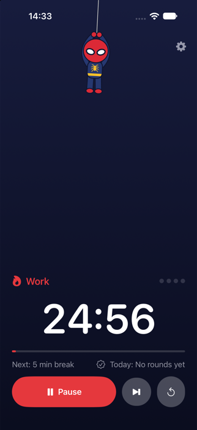
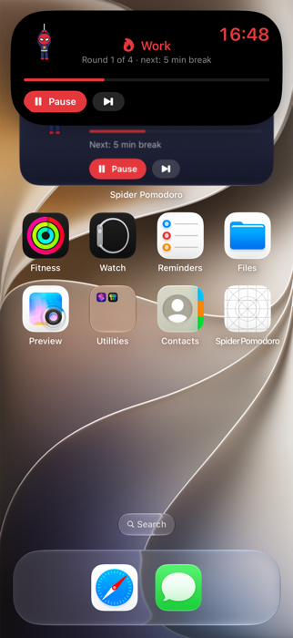
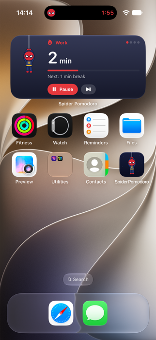
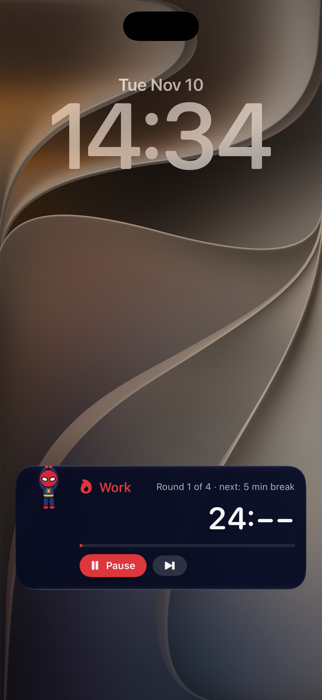
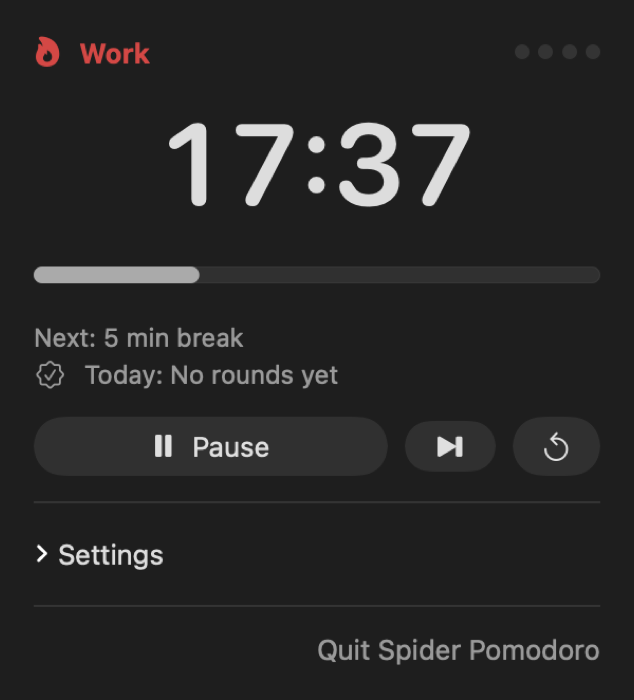
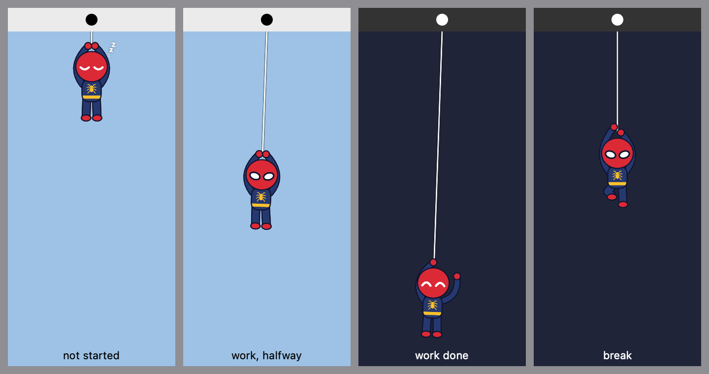

<p align="center">
  
</p>

<h1 align="center">Spider Pomodoro</h1>

<p align="center">
  A pomodoro timer for Mac and iPhone with a little spider hero who hangs from the top of your screen.<br>
  He drops lower as your work time runs out, climbs back up during breaks, and keeps both devices in sync.
</p>

<p align="center">
  <a href="https://github.com/MertcanKarabas/pomodoro-glitch/releases/latest/download/SpiderPomodoro.dmg"><b>Download for Mac</b></a>
  &nbsp;·&nbsp;
  <a href="#iphone">iPhone</a>
  &nbsp;·&nbsp;
  <a href="#build-it-yourself">Build it yourself</a>
</p>

<p align="center">
  
  
  
  
</p>

## What it does

- **Hero on a web.** Work time: the hero hangs from the top and drops as the minutes pass. Break: he climbs back up. Phase over: he waves. Not started: he sleeps.
- **Mac menu bar.** Minutes left (like **24m**) next to the hero icon in the menu bar, and the hero hanging right under it on your desktop. Click the icon for the timer panel. Turn on **Settings → Seconds in menu bar** for a full 24:13 countdown.
- **Move the hero.** Drag him anywhere on your screen and his web starts from there. **Settings → Back under the menu bar** puts him back. Clicks around him still reach the windows underneath.
- **Timer card.** Click the hero for a small card with the countdown, Pause and Skip. Pin it (or just drag it) to keep it on screen as its own window; it comes back after a restart, and it always stays clear of the screen edges and the Dock.
- **Work and breaks.** Sitting on the card or a widget, he types on a little laptop (coffee beside him) while you work, and scrolls his phone on breaks, laughing now and then. On his web during a break he takes turns climbing and hanging on one-handed to scroll his phone.
- **Play with him.** Point at the hero and he waves. Carry him around and he dangles from his hands. Shake him and he gets dizzy; keep shaking and he gets grumpy.
- **Climbing.** Drop the hero on the pinned timer card or a desktop widget and he climbs onto it: near the top edge he sits on it swinging his legs, near the bottom he hangs upside down under it, near a side he grips that side, and in the middle he climbs behind it and peeks over the top. Now and then, at random times (about twice a day; **Settings → Wandering** makes it hourly or every few minutes), he walks or climbs round to another spot. Hanging underneath he sometimes gets out binoculars and spies on it. Point at him and he holds still. He moves with the card when you drag it, and on a desktop widget app windows cover him just like they cover the widget. Drag him off to put him back on his web. (macOS doesn't tell apps which widget is which, so he climbs any desktop widget.)
- **iPhone.** The hero hangs from the Dynamic Island, with a live countdown in the island and on the Lock Screen.
- **Widgets.** Home screen, Lock Screen and Mac desktop widgets with Start/Pause and Skip buttons that work without opening the app.
- **Mac and iPhone in sync.** Press Start on one, the other follows within seconds, through your own iCloud.
- **Alerts.** A notification when work or a break ends, even with the app closed. Can be switched off per device.
- **Today's count.** "Today: 3 rounds · 75 min".
- **Your rhythm.** 25 / 5 / 15 minutes and a long break every 4 rounds by default, all adjustable. Breaks can start by themselves.
- **Light on battery.** The Mac hero is drawn with Core Animation, so he swings, drops and walks inside macOS itself, and the menu bar changes once a minute. The app uses about 0.5% CPU with the timer running and next to nothing while idle.

<p align="center">
  
  
</p>

## Mac

**Requirements:** macOS 15 Sequoia or later, Apple silicon or Intel.

1. [Download **SpiderPomodoro.dmg**](https://github.com/MertcanKarabas/pomodoro-glitch/releases/latest/download/SpiderPomodoro.dmg).
2. Open it and drag **Spider Pomodoro** into **Applications**.
3. Open Spider Pomodoro from Applications. macOS asks once whether you want to open an app downloaded from the internet: choose **Open**. (The app is signed and notarized by Apple.)
4. Allow notifications when asked, so you hear when work or a break ends.
5. Find the hero in your menu bar and press **Start work**.

Add the desktop widget: right-click the desktop → **Edit Widgets** → search "Spider".

To quit, click the hero in the menu bar → **Quit Spider Pomodoro**. To uninstall, drag the app from Applications to the Trash.

### Updates

The app checks GitHub for a new version once a day (from version 1.1 on). When there is one, you get a notification and an **Update available** banner at the top of the panel: click **Download**, open the new `.dmg` and drag the app into Applications again, choosing **Replace**. Your timer and settings stay.

You can also check any time from the panel: **Settings → Check for Updates**, or switch the daily check off there.

## iPhone

iPhone apps can't be installed from a download link, so the iPhone version comes through Apple:

- **TestFlight beta**: coming soon. A public link will appear here; you'll install Apple's free TestFlight app and tap the link.
- **App Store**: planned after the beta.

Until then you can [build it yourself](#build-it-yourself) with Xcode.

The iPhone app works on its own too; with the Mac app on the same iCloud account the two stay in sync.

## Sync and privacy

- Sync uses **your own iCloud** (CloudKit private database). The timer lives in your iCloud account, not on any server of ours.
- Both devices need to be signed in to the same Apple ID with iCloud turned on.
- No accounts, no analytics, no tracking. Nothing leaves your devices except to your iCloud.

## Handy extras

The apps understand these links, so you can use them from Shortcuts, Raycast, Alfred or a script:

```
spiderpomodoro://start
spiderpomodoro://pause
spiderpomodoro://toggle
spiderpomodoro://skip
spiderpomodoro://reset
```

For example on the Mac: `open spiderpomodoro://toggle`

## Build it yourself

You need Xcode 27 or later and [XcodeGen](https://github.com/yonaskolb/XcodeGen) (`brew install xcodegen`).

```bash
git clone https://github.com/MertcanKarabas/pomodoro-glitch.git
cd pomodoro-glitch
```

1. In `project.yml`, change these to your own Apple team and identifiers:
   ```yaml
   DEVELOPMENT_TEAM: YOUR_TEAM_ID
   APP_BUNDLE_ID: com.yourname.spiderpomodoro
   APP_GROUP_ID: group.com.yourname.spiderpomodoro
   CLOUD_CONTAINER_ID: iCloud.com.yourname.spiderpomodoro
   ```
2. Generate the Xcode project and open it:
   ```bash
   xcodegen generate
   open SpiderPomodoro.xcodeproj
   ```
3. Pick **SpiderPomodoroMac** or **SpiderPomodoroiOS** and press Run.

A free Apple ID is enough to run it on your own devices, but iCloud sync and push need a paid Apple Developer account, and apps installed with a free account stop opening after 7 days.

Run the tests:

```bash
cd Packages/SpiderCore && swift test
```

### Releasing a new Mac version

1. Bump `MARKETING_VERSION` in `project.yml` (for example `"1.1"`).
2. Build the signed, notarized disk image (needs Xcode signed in to the Developer ID account):
   ```bash
   scripts/release-mac.sh
   ```
3. Publish it as the latest GitHub release, tagged with the same version. The asset must be named `SpiderPomodoro.dmg`; the app's update check and the README download link look for it:
   ```bash
   gh release create v1.1 build/release/SpiderPomodoro.dmg --title "Spider Pomodoro 1.1" --notes "What's new…"
   ```

### How it's put together

| Folder | What's inside |
|---|---|
| `Packages/SpiderCore` | Timer logic, iCloud sync, hero drawing, widget timeline, button intents, tests |
| `Mac` | Menu bar app and the hanging-hero window |
| `iOS` | iPhone app and the Dynamic Island / Lock Screen Live Activity |
| `Widgets` | Widget and Live Activity views shared by iPhone and Mac |
| `project.yml` | Xcode project definition (XcodeGen) |

The timer is one small value: phase, start time and length. Every device works out the time left from it, so devices only need to talk when someone presses a button. See [PLAN.md](PLAN.md) for the design notes.

## Credits

The spider hero is an original character made for this app. Spider Pomodoro isn't affiliated with or endorsed by Marvel or any other company.

Made by [Mertcan Karabaş](https://github.com/MertcanKarabas). Released under the [MIT License](LICENSE).
